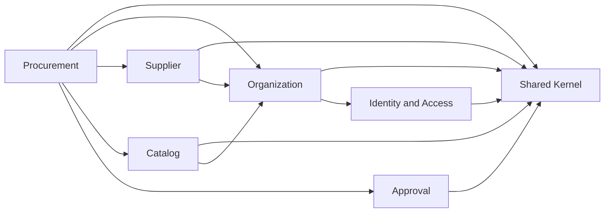

# OpenDepo Phase 1 Technical Blueprint

| Field | Value |
| --- | --- |
| Status | Draft for review |
| Date | 2026-11-09 |
| Scope | Phase 1 — Foundation and Modular Monolith |
| Refines | [`project-architecture.md`](project-architecture.md) |

## 1. Purpose

This document turns the OpenDepo architecture vision into a concrete Phase 1 implementation plan.

Phase 1 delivers a well-structured Spring Boot modular monolith with real business boundaries, a PostgreSQL transactional model, tenant isolation, automated tests and a reproducible local development environment. It is the foundation for the event-driven and distributed phases described in the main architecture document.

The blueprint is intentionally concrete about module boundaries, data ownership, API conventions and security so that implementation tasks do not invent conflicting patterns.

## 2. Phase 1 scope

### In scope

- Modular monolith with Spring Modulith.
- Identity, organization, supplier, product catalog, procurement and approval foundations.
- PostgreSQL as the transactional source of truth.
- Flyway migrations.
- Multi-tenant data isolation.
- Role-based authorization foundation.
- REST API with explicit DTOs and consistent errors.
- Unit, integration and architecture tests.
- Local Docker Compose environment.
- CI baseline and open-source repository documentation.
- MIT licensing compliance.

### Out of scope for Phase 1

- Kafka, RabbitMQ, Debezium and distributed sagas.
- Couchbase, Elasticsearch and Redis integrations.
- Inventory, warehouse and fulfillment implementation.
- Independent microservices.
- Kubernetes, Helm, Terraform and Argo CD.
- Full observability stack.
- Advanced reporting and analytics.

These are added in later phases only when the related business workflows justify them.

## 3. Technology baseline

| Area | Phase 1 choice |
| --- | --- |
| Language | Java 25 LTS |
| Framework | Spring Boot 4.1 |
| Module boundaries | Spring Modulith |
| Web | Spring Web MVC |
| Validation | Jakarta Bean Validation |
| Persistence | Spring Data JPA, Hibernate |
| Database | PostgreSQL 17 |
| Migrations | Flyway |
| Build | Maven with Maven Wrapper |
| Testing | JUnit 5, AssertJ, Mockito, Testcontainers, ArchUnit, Spring Modulith test support |
| API documentation | OpenAPI/Swagger (introduced with the first business API) |
| Local infrastructure | Docker Compose |
| CI | GitHub Actions |

Versions are managed by the Spring Boot and Spring Modulith BOMs. A dependency is added only when an implemented feature needs it.

## 4. Domain-Driven Design analysis

### 4.1 Bounded contexts

| Context | Responsibility | Phase 1 |
| --- | --- | --- |
| Identity and Access | Users, authentication integration, roles and permissions | Yes |
| Organization | Tenants, memberships, organization-level authorization | Yes |
| Supplier | Supplier profiles, contacts, addresses, status and evaluation foundation | Yes |
| Catalog | Product categories, products, pricing and search-ready product data | Yes |
| Procurement | Purchase requisitions, purchase orders and procurement lifecycle | Yes |
| Approval | Configurable approval workflows and decisions | Yes |
| Inventory | Stock, reservations, movements and availability | No |
| Warehouse | Warehouses, locations and receiving/dispatch operations | No |
| Fulfillment | Shipments, carriers and delivery tracking | No |
| Notification | Email, SMS, webhook and in-app notifications | No |
| Audit and Reporting | Immutable audit records and operational reporting | Foundation only |

### 4.2 Context map



### 4.3 Context relationships

- **Organization is the tenant boundary.** Every tenant-owned aggregate carries the organization identifier.
- **Identity is upstream of Organization for user identity.** Organization memberships reference a user identifier but do not own identity data.
- **Supplier and Catalog are upstream of Procurement.** Procurement reads their public APIs; it does not query their tables.
- **Approval is a generic workflow context.** It works with approval subjects by type and identifier and does not depend on Procurement.
- **Notification and Audit are downstream consumers.** They react to public events and do not participate in core write transactions.
- **Shared is a small kernel**, not a dumping ground. It contains only stable, generic types such as identifiers, money, domain event contracts and tenant/user context ports.

## 5. Modular monolith architecture

The application is deployed as one Spring Boot process. Modules communicate through:

1. Public module APIs (Java interfaces and immutable DTOs).
2. Domain events published through Spring Modulith.
3. Explicit application services.

Modules must not:

- Access another module's repositories.
- Join another module's tables.
- Depend on another module's internal packages.
- Use shared database entities as integration contracts.

The module boundaries must be enforceable with Spring Modulith and ArchUnit. A module is extracted into a service only after its operational and scaling needs justify the distributed complexity.

## 6. Package and module structure

Base package: `com.opendepo`.

```text
com.opendepo/
├── OpenDepoApplication.java
├── shared/
├── identity/
├── organization/
├── supplier/
├── catalog/
├── procurement/
└── approval/
```

Each business module follows this internal structure:

```text
<module>/
├── <Module>Api.java        Public cross-module API (module root)
├── <Module>Dto.java        Public immutable DTOs (module root)
├── domain/                 Entities, value objects, aggregates, domain events
├── application/            Use cases, commands, queries, ports, transactions
├── infrastructure/         JPA repositories, adapters, external clients
└── presentation/           REST controllers, request/response DTOs, error mapping
```

Rules:

- The module root package is the public API surface. Keep it small.
- `domain` is plain Java and has no Spring, JPA or messaging dependency.
- `application` coordinates use cases and owns transaction boundaries.
- `infrastructure` implements persistence and external ports.
- `presentation` is internal and exposes REST only.
- Cross-module calls use the public API in the module root, never internal packages.
- `shared` is a Spring Modulith open module; use it only for stable shared concepts.

## 7. Module dependency rules

Allowed dependency direction:

```text
shared
  ↑
identity ← organization ← supplier
                ↑           ↑
                └── catalog ┘
                       ↑
                  procurement → approval
```

| Module | May depend on |
| --- | --- |
| shared | None |
| identity | shared |
| organization | shared, identity |
| supplier | shared, organization |
| catalog | shared, organization |
| approval | shared |
| procurement | shared, organization, supplier, catalog, approval |

Additional rules:

- No circular dependencies.
- No module may depend on `presentation` or `infrastructure` of another module.
- `procurement` may read supplier and catalog data only through their public APIs.
- `approval` must remain business-agnostic; it receives an approval subject type and identifier.
- Future `notification` and `audit` modules consume events and must not become write-path dependencies.

## 8. Data ownership and initial data model

### 8.1 Ownership rules

- Each table has exactly one owning module.
- A module never queries another module's tables.
- Cross-module references store identifiers only. Referential integrity is enforced by the owning module's API, not by cross-module foreign keys.
- Phase 1 uses a single PostgreSQL schema (`public`) with module-owned tables.
- Every tenant-owned table has `organization_id UUID NOT NULL`.
- Use UUID identifiers and expose them as public API identifiers.
- Use `TIMESTAMPTZ` for persisted timestamps and store UTC.
- Use `NUMERIC(19,4)` for monetary amounts and Java `BigDecimal`.
- Mutable aggregates use optimistic locking with a `version BIGINT` column.
- Avoid generic soft-delete flags; model lifecycle with explicit status values.

### 8.2 Phase 1 tables

| Module | Table | Purpose |
| --- | --- | --- |
| identity | `app_user` | Global user profile linked to the identity provider |
| organization | `organization` | Tenant root |
| organization | `organization_membership` | User membership and role in an organization |
| supplier | `supplier` | Supplier profile and lifecycle |
| supplier | `supplier_contact` | Supplier contact people |
| supplier | `supplier_address` | Supplier addresses |
| catalog | `product_category` | Tenant-owned product category tree |
| catalog | `product` | Product master data and pricing |
| procurement | `purchase_requisition` | Internal purchase request |
| procurement | `purchase_requisition_item` | Requisition line items |
| procurement | `purchase_order` | Supplier purchase order |
| procurement | `purchase_order_item` | Purchase order line items |
| approval | `approval_workflow` | Workflow definition |
| approval | `approval_workflow_step` | Ordered approval steps |
| approval | `approval_request` | Approval instance for a subject |
| approval | `approval_decision` | Approval or rejection decision |
| Spring Modulith infrastructure | `event_publication` | Framework event publication registry |

### 8.3 Common columns

Tenant-owned tables:

```text
id              UUID PRIMARY KEY
organization_id UUID NOT NULL
created_at      TIMESTAMPTZ NOT NULL
updated_at      TIMESTAMPTZ NOT NULL
version         BIGINT NOT NULL DEFAULT 0   -- mutable aggregates
```

Index rules:

- Index every tenant-scoped query starting with `organization_id`.
- Add unique constraints scoped by tenant, for example `(organization_id, code)`.
- Add indexes for status and time-based listing queries.
- Use `EXPLAIN ANALYZE` for important queries and avoid N+1 access.

### 8.4 Cross-module reference examples

| Consumer | Reference | Validation |
| --- | --- | --- |
| organization_membership | user_id | Identity API |
| supplier | organization_id | Organization API |
| product | organization_id | Organization API |
| purchase_order | supplier_id | Supplier API |
| purchase_order_item | product_id | Catalog API |
| approval_request | subject_type + subject_id | Generic approval subject |

## 9. Aggregates and invariants

| Aggregate | Module | Key invariants |
| --- | --- | --- |
| User | identity | Unique email per identity provider; explicit active/disabled status |
| Organization | organization | Unique slug; must retain at least one active owner |
| Membership | organization | One membership per user and organization; role must be valid |
| Supplier | supplier | Unique supplier code per organization; valid status transition |
| Product | catalog | Unique SKU per organization; non-negative price; valid currency |
| PurchaseRequisition | procurement | At least one item; only draft requisitions can be submitted |
| PurchaseOrder | procurement | Valid state transitions; submitted orders require approval; totals are derived from items |
| ApprovalWorkflow | approval | Ordered steps; at least one step; active workflow is immutable |
| ApprovalRequest | approval | One decision per approver per step; terminal state cannot change |

Purchase order lifecycle:

```text
DRAFT → PENDING_APPROVAL → APPROVED → ORDERED
                                  ↘ CANCELLED
ORDERED → PARTIALLY_RECEIVED → COMPLETED
```

The lifecycle is modeled explicitly. Invalid transitions must fail in the domain layer, not in controllers.

## 10. Database responsibilities

| Store | Phase 1 responsibility |
| --- | --- |
| PostgreSQL | Transactional source of truth for all business data and the event publication registry |
| Couchbase | Deferred: dynamic product documents and category-specific attributes |
| Elasticsearch | Deferred: derived search projections |
| Redis | Deferred: cache, rate limiting and short-lived data |

PostgreSQL is not optional infrastructure. Caches and search indexes must never become the authoritative source for business decisions.

## 11. Events and consistency

### 11.1 Phase 1 event model

- Use Spring Modulith application events for in-process decoupling.
- Publish domain events after aggregate state changes.
- Persist event publications through the Modulith JPA registry, which is the Phase 1 outbox.
- Use `@ApplicationModuleListener` for asynchronous after-commit side effects.
- Do not use asynchronous events to replace a required synchronous business decision.

Initial event names:

- `OrganizationCreated`
- `OrganizationMemberInvited`
- `OrganizationMemberActivated`
- `SupplierRegistered`
- `SupplierUpdated`
- `ProductCreated`
- `ProductUpdated`
- `PurchaseRequisitionSubmitted`
- `PurchaseOrderCreated`
- `PurchaseOrderApproved`
- `PurchaseOrderCancelled`

Event envelope fields:

```text
eventId        UUID
eventType      String
eventVersion   int
aggregateId    UUID
organizationId UUID
occurredAt     Instant (UTC)
correlationId  String
causationId    String
payload        Versioned immutable payload
```

### 11.2 Later phases

- Kafka for external domain event streaming.
- RabbitMQ for retryable background tasks.
- Transactional outbox and Debezium CDC for reliable broker publishing.
- Idempotent consumers with an inbox/deduplication table.
- Sagas for multi-service workflows.

Phase 1 must not assume that a local transaction and a future broker publish are atomic.

## 12. Security and multi-tenancy

### 12.1 Authentication

- Use Keycloak or another OIDC provider for authentication.
- The resource server validates JWT access tokens.
- Do not build a custom identity provider.
- User records in `app_user` correspond to identity-provider subjects.

### 12.2 Tenant context

- The active organization is carried in the authenticated token (`org_id` claim).
- A request without a valid tenant context is rejected for tenant-owned endpoints.
- Membership and role are validated on every tenant-scoped request.
- Never trust a client-supplied organization identifier without membership validation.
- Switching organizations requires a new token or an explicit, validated organization-selection flow.

### 12.3 Authorization

Use role-based authorization for Phase 1:

| Role | Typical responsibility |
| --- | --- |
| OWNER | Organization ownership and administration |
| ADMIN | Organization configuration and user management |
| PROCUREMENT_MANAGER | Suppliers, catalog and procurement oversight |
| BUYER | Requisitions, quotes and purchase orders |
| APPROVER | Approval decisions |
| VIEWER | Read-only access |

Authorization is enforced in the application layer and at the API boundary. A user must not read or mutate another organization's data by changing an identifier.

### 12.4 Other security requirements

- Validate all inputs.
- Use consistent, non-leaking error responses.
- Do not expose stack traces or secrets.
- Configure CORS and secure HTTP headers explicitly.
- Rate-limit public endpoints when the API is exposed.
- Record immutable audit entries for critical operations.
- Scan dependencies and container images in CI.
- Never commit secrets or production credentials.

## 13. API conventions

### 13.1 Paths

Base path: `/api/v1`.

Examples:

```text
GET    /api/v1/organizations/current
GET    /api/v1/suppliers
POST   /api/v1/suppliers
GET    /api/v1/products/{productId}
POST   /api/v1/purchase-requisitions
POST   /api/v1/purchase-requisitions/{id}/submit
POST   /api/v1/purchase-orders/{id}/approve
```

- Use plural nouns and kebab-case paths.
- Use HTTP methods according to semantics.
- Do not put the tenant identifier in the path for tenant-owned resources.
- Use explicit action sub-resources for non-CRUD business operations.

### 13.2 Error contract

Use RFC 9457 Problem Details (`application/problem+json`):

```json
{
  "type": "https://opendepo.example/problems/validation-error",
  "title": "Validation failed",
  "status": 400,
  "detail": "One or more fields are invalid.",
  "instance": "/api/v1/suppliers",
  "code": "VALIDATION_ERROR",
  "traceId": "4f9c2d7e",
  "errors": [
    { "field": "name", "message": "must not be blank" }
  ]
}
```

### 13.3 Pagination and filtering

- Collection endpoints use `page`, `size` and `sort` parameters.
- Responses include `content`, `page`, `size`, `totalElements` and `totalPages`.
- Use cursor pagination later for very large, append-only datasets.
- Filter parameters are explicit and validated; do not accept arbitrary query fragments.

### 13.4 Other rules

- Use explicit request and response DTOs.
- Never expose JPA entities from controllers.
- Validate inputs with Jakarta Bean Validation.
- Document endpoints with OpenAPI.
- Use idempotency keys for retryable create operations when implemented.
- Keep API changes backward compatible or version them explicitly.

## 14. Testing strategy

| Test type | Scope | Tools |
| --- | --- | --- |
| Unit | Domain rules, aggregates, value objects, state machines | JUnit 5, AssertJ |
| Integration | Repositories, Flyway, transactions, event publication | Testcontainers PostgreSQL, Spring Boot test |
| Architecture | Module boundaries, layering, dependency direction | Spring Modulith, ArchUnit |
| API | Controllers, validation, error mapping, security | MockMvc or REST Assured |
| Contract | Event and API contracts | Pact or schema compatibility tools (later) |
| Performance | Throughput, latency, database behavior | Gatling or k6 (later) |
| Resilience | Dependency failures and retries | Toxiproxy, Chaos Mesh (later) |

Rules:

- Domain tests require no Spring context.
- Integration tests use real PostgreSQL through Testcontainers; do not substitute H2 for PostgreSQL behavior.
- Every new business rule has a unit test.
- Every new repository or migration has an integration test where it adds value.
- Every module boundary change is covered by an architecture test.
- A feature is not done until its relevant tests pass.

## 15. Local development

Phase 1 infrastructure:

```text
docker compose up -d --wait
```

Services:

- PostgreSQL 17 on host port `5433` to avoid conflicts with an existing local PostgreSQL.
- Future services are added to the same Compose file when their phase starts.

Configuration is environment based:

- `OPEN_DEPO_DB_URL`
- `OPEN_DEPO_DB_USERNAME`
- `OPEN_DEPO_DB_PASSWORD`

Local defaults are documented in [`.env.example`](../../.env.example). Do not commit `.env` files.

## 16. CI/CD and observability baseline

### 16.1 CI

The first CI pipeline must run on every pull request:

1. Formatting check.
2. Compilation.
3. Unit tests.
4. Integration tests with Testcontainers.
5. Architecture tests.
6. Application packaging.
7. Dependency vulnerability check.

Container build and image scanning are added when a production Docker image exists. GitOps and Argo CD are added in a later phase.

### 16.2 Observability

Phase 1 baseline:

- Actuator health and info endpoints.
- Structured application logs with correlation identifiers.
- Request and error metrics when the first API is introduced.
- Health checks that do not depend on non-critical downstream services.

OpenTelemetry, Prometheus, Grafana, Loki and Tempo are introduced in a later phase.

## 17. Licensing

OpenDepo is licensed under the MIT License.

- Preserve the root [`LICENSE`](../../LICENSE).
- Add `SPDX-License-Identifier: MIT` to new source files where appropriate.
- Do not add restrictions beyond MIT.
- Do not copy code from projects with incompatible licenses.
- Third-party dependencies remain under their own licenses.
- Document separately licensed assets if any are added.

## 18. Key decisions and trade-offs

| Decision | Why | Trade-off |
| --- | --- | --- |
| Modular monolith first | Fast delivery, strong consistency, simple operations | Requires discipline to preserve boundaries |
| Spring Modulith | Verifiable module boundaries and in-process events | Adds framework-specific conventions |
| PostgreSQL primary database | Transactions, constraints, mature tooling | Does not fit highly dynamic documents |
| Single schema in Phase 1 | Simple Flyway setup and local development | Cross-module DB access must be prevented by code review and tests |
| UUID identifiers | Stable public identifiers, no sequence leakage | Random UUIDs have less index locality than time-ordered IDs |
| Keycloak/OIDC | Avoid building identity from scratch | Operational dependency and integration complexity |
| Static roles in Phase 1 | Simpler authorization model | Configurable permissions are deferred |
| Testcontainers | Tests real PostgreSQL behavior | Requires Docker in development and CI |

Detailed records are in [`docs/adr/`](../adr/).

## 19. Delivery roadmap

| Milestone | Outcome |
| --- | --- |
| M1 Foundation | Repository docs, Spring Boot skeleton, PostgreSQL/Flyway/Modulith, initial test (done) |
| M2 Quality baseline | Spotless, ArchUnit, Modulith tests, OpenAPI baseline, GitHub Actions (done) |
| M3 Security and tenancy | OIDC/Keycloak integration, tenant context, authorization, problem details |
| M4 Organization | Organization and membership vertical slice with tests |
| M5 Supplier | Supplier profile, contacts, addresses and status lifecycle |
| M6 Catalog | Categories, products and pricing foundation |
| M7 Procurement and approval | Requisition, purchase order and configurable approval flow |
| M8 Hardening | Test coverage, documentation, ADR review, operational readiness |

Each milestone is delivered as small, independently testable changes. No milestone starts with a full module implementation in one pass.

## 20. Phase 1 task breakdown

### M2 — Quality baseline

- [x] Add Spotless and a formatting check.
- [x] Add ArchUnit and Spring Modulith test dependencies.
- [x] Add an architecture test that verifies module boundaries.
- [x] Add GitHub Actions CI with JDK 25 and Testcontainers.
- [x] Add OpenAPI baseline and API documentation endpoints.
- [x] Add Maven Enforcer with a JDK 25 requirement.

Acceptance criteria:

- [x] A pull request fails on formatting, compilation, test or architecture violations.
- [x] The full build runs from a clean checkout with documented commands.

### M3 — Security and tenancy

- Add Spring Security OAuth2 resource server configuration.
- Add Keycloak to the local development Compose stack.
- Implement tenant context resolution and membership validation.
- Implement the RFC 9457 error contract.
- Add security integration tests.

Acceptance criteria:

- Tenant-owned endpoints reject unauthenticated, unauthorized and cross-tenant requests.
- No endpoint trusts a client-supplied organization identifier without validation.

### M4 — Organization

- Implement the Organization aggregate and membership model.
- Add Flyway migration.
- Add application use cases for creation, update and membership management.
- Add REST endpoints and DTOs.
- Add unit, integration and API tests.

Acceptance criteria:

- An organization can be created and administered.
- Membership rules and role assignment are enforced.
- Cross-tenant access is impossible.

### M5 — Supplier

- Implement supplier profile, contacts, addresses and lifecycle.
- Add migrations and API.
- Add domain and integration tests.

### M6 — Catalog

- Implement categories, products and pricing.
- Keep dynamic category attributes in mind for the Couchbase phase.
- Add search-ready product projections later.

### M7 — Procurement and approval

- Implement requisitions and purchase orders.
- Implement the approval workflow and decisions.
- Publish the first business events.
- Add end-to-end business flow tests.

## 21. Coverage of the initial blueprint requirements

| Requirement | Coverage |
| --- | --- |
| Product scope and functional boundaries | §2 |
| DDD analysis | §4 |
| Bounded context definitions | §4.1 |
| Context map | §4.2 |
| Modular monolith architecture | §5 |
| Package and module structure | §6 |
| Database ownership and initial data model | §8 |
| Main entities, aggregates and relationships | §9 |
| PostgreSQL, Couchbase, Elasticsearch and Redis responsibilities | §10 |
| Kafka topic and event design | Deferred to Phase 3 |
| RabbitMQ exchange, routing key and queue design | Deferred to Phase 3 |
| Transactional Outbox and Inbox architecture | §11 (Modulith registry now; Kafka outbox later) |
| Saga workflow design | Deferred to Phase 3 |
| Security and multi-tenancy architecture | §12 |
| Testing strategy | §14 |
| Docker Compose architecture | §15 |
| Kubernetes deployment strategy | Deferred to Phase 5 |
| Terraform infrastructure plan | Deferred to Phase 5 |
| CI/CD and GitOps pipeline | §16 (CI baseline now; GitOps later) |
| Observability architecture | §16 (baseline now; full stack later) |
| MIT licensing and repository compliance | §17 |
| Key architecture decisions and trade-offs | §18 and ADRs |
| Incremental implementation roadmap | §19 |
| Initial GitHub issues grouped by phase | §20 (issue creation follows milestone review) |

## 22. Open questions and risks

### Open questions

1. Should active organization selection use a Keycloak token exchange or an explicit organization switcher endpoint?
2. Are Phase 1 roles sufficient, or is configurable permission management required earlier?
3. Should product core data stay in PostgreSQL while dynamic attributes move to Couchbase, and where is the boundary?
4. Should approval workflows support parallel steps in Phase 1 or only ordered sequential steps?
5. What is the retention and archival policy for `event_publication` records?

### Risks

- **Scope creep:** Adding future-phase infrastructure before the business need exists.
- **Boundary erosion:** Cross-module repository access or shared entities.
- **Identity complexity:** Keycloak integration and organization switching can expand quickly.
- **Dynamic catalog data:** Product attributes may be modeled too rigidly for later Couchbase migration.
- **Operational load:** Too many local services can make onboarding difficult.
- **Test environment:** Integration tests require Docker and must remain reliable in CI.

## 23. References

- [Project architecture](project-architecture.md)
- [ADR index](../adr/README.md)
- [Repository README](../../README.md)
- [Agent and contributor guide](../../AGENTS.md)
